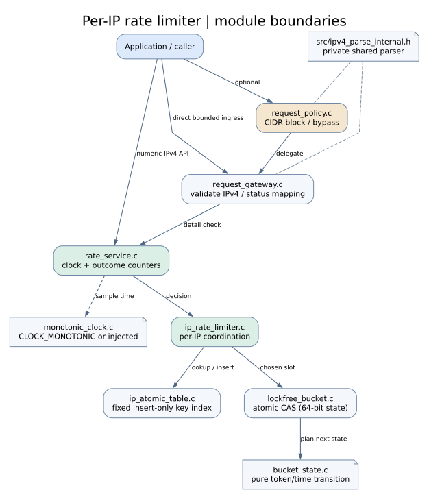

# Design notes and verification

This page collects the main implementation choices for the C11 per-IP rate limiter (`0.1.0`, unreleased). The project produces an in-process static library, not a network service or HTTP server.

## Request path



- An optional immutable CIDR policy bypasses or rejects configured ranges.
- The request adapter parses length-bounded IPv4 input and distinguishes malformed input from service failures.
- The service reads an injected or monotonic clock and looks up the address in a preallocated, open-addressed atomic table.
- A bucket stores a 48-bit refill timestamp and 16-bit token count in one atomic 64-bit word. Failed CAS operations reload state and recompute the transition.
- The mutex baseline shares the same indexing and transition rules, so the benchmark can focus on the synchronization difference.

Publishing an IP key and consuming a token are separate CAS operations. A lock-free bucket update does not imply that all library operations are lock-free.

## Trade-offs

| Choice | Benefit | Limitation |
| --- | --- | --- |
| Packed bucket word | Token and refill state change together | 48-bit time and 16-bit token bounds |
| Preallocated, insert-only table | No allocation on the request path | No eviction or resizing; new IPs can be rejected when full |
| Injected clock | Reproducible boundary tests | Callback contract belongs to the caller |
| Immutable CIDR policy | No rule-update synchronization during reads | Configuration cannot change concurrently |
| Shutdown after worker joins | Straightforward object lifetime | No concurrent destruction or memory reclamation |
| Optional padded buckets | May reduce cache-line contention | Higher memory use; depends on workload |

Further details: [architecture decisions](architecture_decisions.md).

## Checks worth running

```bash
make lockfree-test
make contention-test
make impossible-request-test
make api-contract-test
make audit-test
make package-test
make evidence-smoke
```

The tests check particular executions, contracts, and error paths. The history checker works on bounded traces, and sanitizer coverage depends on exercised paths. `make package-test` links against staged installed headers and the archive. `make evidence-smoke` checks report generation; it should not be treated as a benchmark result.

For longer benchmark runs, repeat measurements on the same machine and preserve environment details and raw samples. There is no universal speedup: a CAS implementation is not necessarily faster than a mutex for every access pattern.

## Useful source files

- `src/bucket_state.c` — packed-state transitions and bounds.
- `src/lockfree_bucket.c` — bucket CAS loop.
- `src/ip_atomic_table.c` — concurrent IPv4 index.
- `src/ip_rate_limiter.c` — per-IP quota handling.
- `bench/mutex_compare.c` — synchronization baseline.

The [demo notes](project_demo.md), [API reference](public_api_reference.md), and [production-readiness notes](production_readiness.md) cover running the examples and integrating the code safely.
