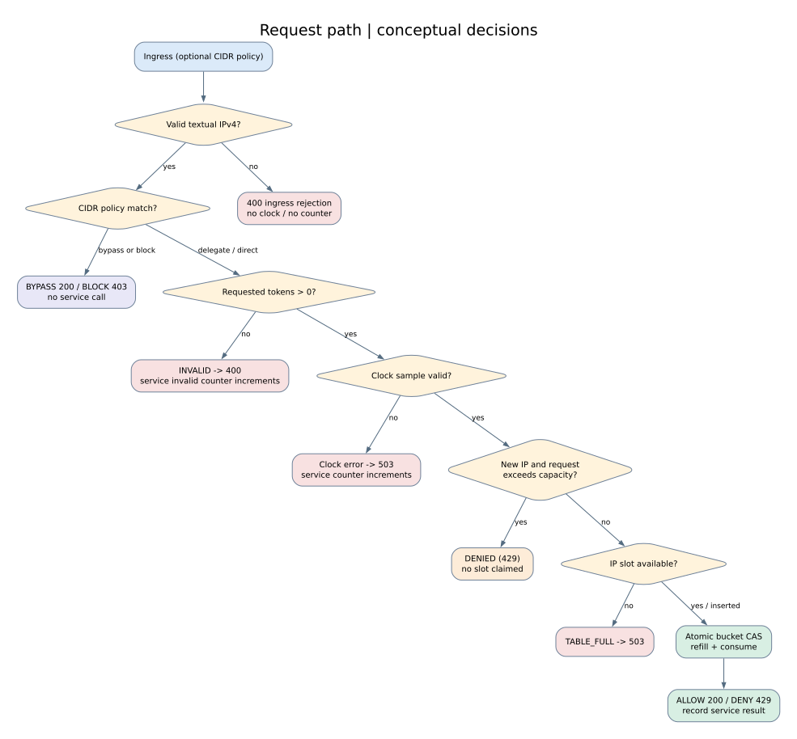
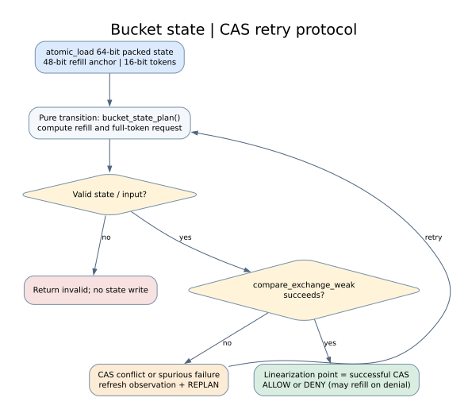
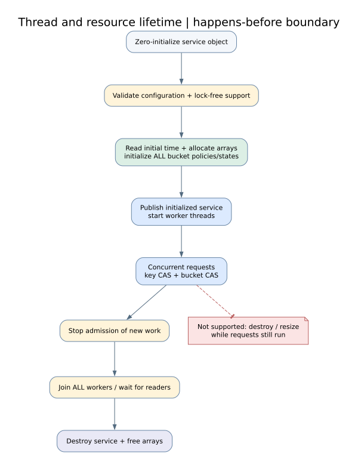

# System architecture | Phase 36

This note describes the implementation as of Phase 36 (version 0.1.0,
**Unreleased**). Diagrams are editable Graphviz DOT sources in
[`docs/diagrams/`](diagrams/) with committed SVG renderings for GitHub readers.
The separate personal learning PDF is intentionally NOT committed.

## 1. Component diagram


Source: [`components.dot`](diagrams/components.dot).

Application callers may use the numeric `rate_service_check*` APIs directly,
use `request_gateway_handle_n()` for a *bounded textual IPv4 view*, or call
`request_policy_handle()` with a conventional NUL-terminated string. A policy
match may bypass or block without delegating to the service. The gateway maps
service outcomes to *illustrative* HTTP-style numbers: it does **not** open
sockets or emit HTTP responses.

The private parser (`src/ipv4_parse_internal.h`) normalizes dotted IPv4 input
to host-order `uint32_t`. It is not an installed public header. The immutable
CIDR table and gateway share it. An application must obtain the client IP from
a **trusted** network/proxy boundary; the library cannot authenticate such
claims itself.

`rate_service.c` samples either an injected clock or Linux `CLOCK_MONOTONIC`,
then delegates to `ip_rate_limiter.c`. The latter owns two preallocated arrays:
a fixed-size atomic IPv4 key index and a matching array of token buckets.
Each new IP is permanently assigned a slot (no eviction or resize). Token
consumption uses `lockfree_bucket.c` and the pure `bucket_state.c` transition.

## 2. Request decisions and error accounting



Source: [`request_path.dot`](diagrams/request_path.dot).

This is a **conceptual** path across optional adapters; it does not depict a
single monolithic C function. The API behavior differs by boundary:

| Outcome | Rate-service call? | Service counter increment? | Effect on new IP slot |
| --- | --- | --- | --- |
| Malformed textual IPv4 at ingress | No | No | None |
| CIDR BYPASS / BLOCK | No | No | None |
| Zero tokens with valid IPv4 | Yes, if service initialized | INVALID | None |
| Clock callback fails | Yes | CLOCK_ERROR | None |
| Unseen IP and request > bucket capacity | Yes | DENIED | None |
| New IP when table is full | Yes | TABLE_FULL | None |
| Admitted or quota-denied eligible request | Yes | ALLOWED / DENIED | Slot may be claimed |

Never conflate **429 quota exhaustion** with **503 capacity exhaustion** or
**403 local policy blocking**. The zero-token invalid outcome is recorded
only for an initialized service. Diagnostic token counts come from the same
successful CAS as a bucket decision but may become stale immediately after
return. Retry hints are earliest eligibility estimates, not admission promises.

## 3. Packed-state CAS protocol



Source: [`cas_state.dot`](diagrams/cas_state.dot).

A single `_Atomic uint64_t` packs the last-refill timestamp in **48 bits**
(milliseconds) and the token balance in **16 bits**. Limits include
capacity 1..65535 and time 0..2^48 - 1 ms. The transition planner calculates
both refill and consumption from one observed state, then retries on CAS
failure using the refreshed observation. A denial can still commit a refill.
The successful CAS in `lockfree_bucket.c` is the bucket decision's
**linearization point**. Atomic key insertion has its **own separate CAS**.
The composite per-IP lookup-and-consume operation must not be described as
having one universal CAS linearization point.

The per-bucket CAS protocol is lock-free on platforms that pass the runtime
`atomic_is_lock_free()` capability checks. One individual call is not
wait-free. Application callbacks such as the injected clock may block, so
**do not claim that all external API calls are lock-free**.

## 4. Initialization, worker lifetime and cleanup



Source: [`lifecycle.dot`](diagrams/lifecycle.dot).

Initialize the entire service, all slot storage and every bucket *before*
allowing any worker request. Publishing a key during a request selects an
already initialized bucket; it does not begin payload initialization.
Configuration and CIDR rules become immutable during worker activity.
A calling application must stop ingress, join every worker (and other reader)
then call `rate_service_destroy()`. Concurrent destroy, resizing and
reinitialization are outside the API contract; there is no reclamation scheme.
Memory allocation occurs at setup and never in the request hot path.

`rate_service_get_stats()` loads five relaxed atomics. Each value is safe to
read, but their combined snapshot is **not transactional** while requests are
running. Compare totals after all worker threads have joined.

## 5. Design choices and important exclusions

Read [Architecture Decision Records](architecture_decisions.md) for the
trade-offs behind fixed-capacity open addressing, packed state, clock
injection, immutable policy, and an optional 64-byte padded layout.

This project deliberately does **not** implement a socket listener, IPv6,
eviction or concurrent resizing, concurrent destruction, authenticated proxy
identity, wait-free per-request progress, stable pre-1.0 ABI or universal
performance superiority over a mutex implementation. Benchmarks are in-process
experiments, not network throughput. Version remains 0.1.0 Unreleased.

## 6. Verification

```bash
make architecture-docs-test
make architecture-diagrams   # requires Graphviz 'dot'; rewrites committed SVGs
make package-test
make rate-service-test
make request-policy-test
make impossible-request-test
make static-check
```

`make architecture-docs-test` uses only the Python standard library, checks
all four DOT/SVG pairs and important source/API invariants, and runs with
`make test` in CI. It does not claim to formally prove algorithm correctness.
The render target intentionally requires Graphviz as an optional developer
dependency, not a mandatory CI requirement.
